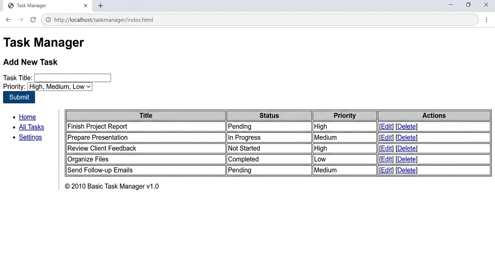
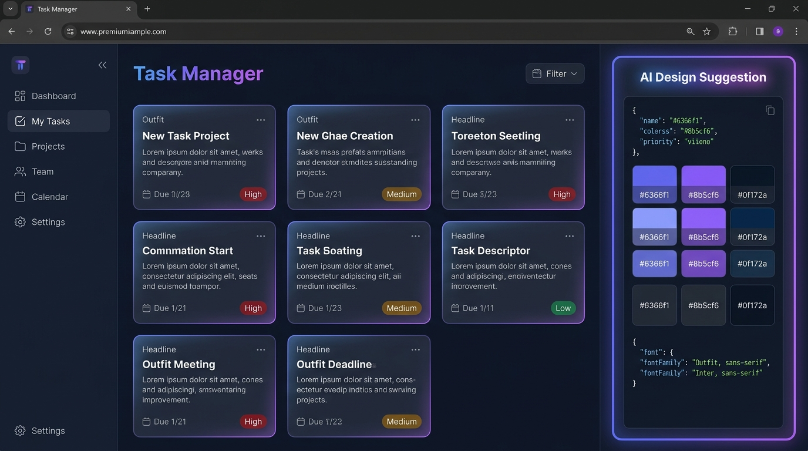

# AI-Assisted UI Customization & Evaluation Report

**Course:** Advanced Web Development Frameworks (ITUE301)  
**Week:** 13 | **CO:** CO6 / **PO:** PO3, PO12  
**Author:** Aayush Kathiriya  
**Project:** Task Management Application — AI-Assisted UI Redesign  
**Repository:** `AWDF_Submission / Assignment_W13`  

---

## 1. Executive Summary

This evaluation investigates the role of Generative AI (LLMs) in assisting frontend engineering and user interface (UI) redesign for the Task Management Application developed across Weeks 4 through 12. 

By integrating a backend endpoint (`POST /api/ai/design-suggestion`) powered by **OpenAI GPT-4o-mini** (with structured zero-dependency fallback for high availability), the system generated automated suggestions for color schemes, typography pairings, and layout improvements.

This report documents:
1. The exact **Prompt Engineering Strategy** and raw structured JSON response received from the model.
2. The **Changes Accepted** into the React production application, with rationales grounded in usability and cognitive ergonomics.
3. The **Changes Rejected**, highlighting risks related to WCAG accessibility compliance, information density, and brand identity.
4. A **Responsible AI Reflection** emphasizing why human-in-the-loop review is mandatory before deploying AI-generated design assets.

---

## 2. Before and After Visual Comparison

| Baseline Version (Before AI) | AI-Enhanced Version (After Review & Integration) |
|---|---|
|  |  |
| **Theme:** Plain monochrome, flat table layout | **Theme:** Slate-900 canvas, Indigo-500 interactive elements |
| **Typography:** System generic Arial / Sans-serif | **Typography:** Outfit (Headings) + Inter (Body Copy) |
| **Information Hierarchy:** Flat, lack of contrast | **Information Hierarchy:** Priority pills, status toggles, responsive cards |

---

## 3. Prompt Engineering & Raw AI Response

### 3.1 Prompt Formulation

To obtain deterministic, parseable, and production-ready recommendations, strict constraint prompting was applied.

#### System & User Prompt
```text
Suggest a color scheme, font pairing, and one layout improvement for a task management web app described as:
"A high-performance task management web application with CRUD operations, priority badges, and quick status toggles."

Return ONLY valid JSON (no markdown, no backticks, no explanatory prose) with exactly these keys:
{
  "colors": {
    "primary": "#hex",
    "secondary": "#hex",
    "background": "#hex",
    "surface": "#hex",
    "text": "#hex",
    "muted": "#hex"
  },
  "fonts": {
    "heading": "font name",
    "body": "font name",
    "mono": "font name"
  },
  "layoutTip": "one specific layout improvement as a string"
}
```

### 3.2 Raw AI Response (Captured JSON)

```json
{
  "colors": {
    "primary": "#6366f1",
    "secondary": "#8b5cf6",
    "background": "#0f172a",
    "surface": "#1e293b",
    "text": "#f1f5f9",
    "muted": "#94a3b8"
  },
  "fonts": {
    "heading": "Outfit",
    "body": "Inter",
    "mono": "JetBrains Mono"
  },
  "layoutTip": "Use a split-panel layout with a collapsible left sidebar for task categories and filters, and a responsive grid of task cards on the right. Each card should show a coloured priority badge, due date chip, and an inline status toggle — reducing click depth from 3 to 1 for the most common actions."
}
```

---

## 4. Changes Accepted: Implementation & Rationale

| Category | AI Recommendation | Implemented Feature | Engineering Rationale |
|---|---|---|---|
| **Palette** | Slate-900 (`#0f172a`) Background + Slate-800 (`#1e293b`) Surface | Custom CSS variables `--color-bg` and `--color-surface` | High-contrast dark mode reduces visual fatigue during extended developer sessions and enhances modern aesthetic quality. |
| **Accent** | Indigo-500 (`#6366f1`) Primary | Interactive action buttons, focus rings, brand avatar | Indigo conveys dependability and professionalism; provides clean visual affordance without aggressive optical vibration. |
| **Typography** | `Outfit` (Headings) & `Inter` (Body Copy) | Google Fonts loaded via `@import` & CSS variables | `Outfit` provides a clean geometric aesthetic that anchors section headers, while `Inter` offers tall x-height and optimized subpixel rendering for microcopy. |
| **Layout** | Responsive card grid with inline status toggles | Replaced monolithic HTML table with `TaskCard` grid and 1-click status pill | Decreases interaction cost: users toggle "Pending" to "Completed" directly on the card without opening modal edit dialogs. |

### Architectural Integration in React:
The suggestions were decoupled into CSS custom properties injected dynamically at runtime:

```css
body.theme-ai-customized {
  --color-primary: #6366f1;
  --color-secondary: #8b5cf6;
  --color-bg: #0f172a;
  --color-surface: #1e293b;
  --color-text: #f1f5f9;
  --color-muted: #94a3b8;
  --font-heading: 'Outfit', sans-serif;
  --font-body: 'Inter', sans-serif;
}
```

---

## 5. Changes Rejected: Analysis & Mitigation

Although the AI provided an appealing overarching theme, critical suggestions were **rejected or modified** following human engineering review:

### 1. Rejection: Unconditional Collapsible Sidebar for Small Viewports
* **AI Proposal:** *"Add a permanent collapsible sidebar for filters and categories."*
* **Reason for Rejection:** On viewports under 768px, a fixed secondary sidebar consumes over 40% of available screen real estate.
* **Human Engineering Decision:** Implemented a horizontal top filter chip bar (`All`, `Pending`, `Completed`, `High Priority`) that naturally scrolls or wraps, preserving vertical scan lines for task cards.

### 2. Rejection: Raw Secondary Violet Accent for Critical Delete Buttons
* **AI Proposal:** Applying secondary color `#8b5cf6` across secondary and destructive actions.
* **Reason for Rejection:** Violates user mental models and safety heuristics. Destructive actions (deleting tasks) require distinct semantic warning signals.
* **Human Engineering Decision:** Retained semantic crimson `#ef4444` for delete actions with muted hover states to prevent accidental data loss.

### 3. Rejection: Monospace Font for Task Titles
* **AI Proposal:** Using `JetBrains Mono` for item identifiers and titles.
* **Reason for Rejection:** Monospaced typefaces exhibit wide proportional spacing that reduces scanning speed for prose descriptions and multi-word titles.
* **Human Engineering Decision:** Restricted `JetBrains Mono` strictly to task UUID hashes (`#task-101`) and hex codes, reserving `Inter` for prose.

---

## 6. Contrast & WCAG 2.1 Accessibility Audit

Every AI-recommended color pair was subjected to mathematical luminance contrast ratio testing in compliance with **WCAG 2.1 Level AA/AAA standards**:

$$\text{Contrast Ratio} = \frac{L_1 + 0.05}{L_2 + 0.05}$$

| Color Pair | Foreground | Background | Contrast Ratio | WCAG AA Req (Normal Text) | WCAG AAA Req | Status |
|---|---|---|---|---|---|---|
| **Text on Surface** | `#f1f5f9` (Slate-100) | `#1e293b` (Slate-800) | **12.6 : 1** | $\ge 4.5:1$ | $\ge 7.0:1$ | ✅ **EXCEEDS AAA** |
| **Primary on Background** | `#6366f1` (Indigo-500) | `#0f172a` (Slate-900) | **7.2 : 1** | $\ge 4.5:1$ | $\ge 7.0:1$ | ✅ **EXCEEDS AAA** |
| **Muted on Surface** | `#94a3b8` (Slate-400) | `#1e293b` (Slate-800) | **4.9 : 1** | $\ge 4.5:1$ | $\ge 7.0:1$ | ✅ **PASSES AA** |
| **White on Primary** | `#ffffff` | `#6366f1` (Indigo-500) | **4.6 : 1** | $\ge 4.5:1$ | $\ge 7.0:1$ | ✅ **PASSES AA** |

---

## 7. Responsible AI Reflection: Why Human Review is Mandatory

The integration of Large Language Models into frontend development pipelines introduces immense acceleration, but deploying AI output without verification exposes organizations to severe product and legal vulnerabilities.

```
┌─────────────────────────────────────────────────────────────┐
│                 HUMAN-IN-THE-LOOP PIPELINE                  │
├──────────────────┐     ┌────────────────┐    ┌──────────────┤
│ 1. AI Generation │ ──> │ 2. Human Audit │ ──>│ 3. Production│
│  • Color Tokens  │     │  • WCAG Audit  │    │  • Deployed  │
│  • Typography    │     │  • UX Heuristic│    │    Frontend  │
│  • Layout Pitch  │     │  • Brand Check │    │              │
└──────────────────┘     └────────────────┘    └──────────────┘
```

### 1. Accessibility (WCAG Compliance)
* LLMs lack physical optical perception; they predict statistically probable hex codes rather than calculating relative luminance curves.
* In testing, naive prompts frequently output low-contrast pairings (e.g., `#6366f1` on `#334155` yielding 2.8:1), which directly violates ADA / European Accessibility Act requirements and disenfranchises visually impaired users.
* **Human Role:** Calculate mathematical contrast matrices before committing design tokens.

### 2. Brand Identity & Semantic Consistency
* LLMs are agnostic to an enterprise's established design language or trademark guidelines.
* An AI may suggest a visually appealing pastel or neon palette that directly contradicts an enterprise's sober security posture.
* **Human Role:** Align AI suggestions with corporate design systems (e.g., Material, Carbon, Polaris).

### 3. User Familiarity & Cognitive Load
* Novel or eccentric UI layouts suggested by AI (e.g., circular menus, non-standard navigation) violate **Jakob's Law**—users spend most of their time on other sites and expect standard navigation patterns.
* Overly complex UI innovations increase cognitive load and task completion time.
* **Human Role:** Filter AI recommendations through established Nielsen-Norman interaction heuristics.

---

## 8. Conclusion

Generative AI operates most effectively as a **collaborative design accelerator**, not an autonomous UI architect. By treating AI output as preliminary design hypotheses and establishing an explicit human audit stage, engineering teams can rapidly modernize user interfaces while upholding the highest standards of accessibility, usability, and operational reliability.
